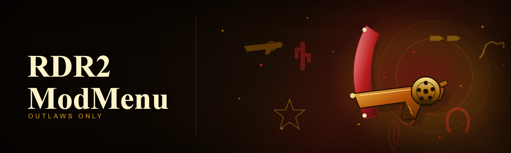

  

  
  
  

  

  
  

---

A community-built **RDR2 ModMenu** for Red Dead Redemption 2 — trainer, ESP, aimbot, and script loader in one tray. If you've ever spent an evening juggling three different `.asi` loaders that each fight over the same ScriptHookRDR2 slot, this repo is the rewrite that finally stopped the whack-a-mole.

## 😤 The Problem

- **Loader collisions.** Legacy RDR2 ModMenu builds all hook `ScriptHookRDR2.dll` the same way and stomp each other on launch.
- **No visible state.** You can't tell if the trainer actually attached, or if you're staring at a menu that silently failed.
- **Bypass churn.** Every RDR2 patch rotates the offsets, and half the forums still link to a 2021 build that crashes on load.
- **Opaque internals.** Most menus ship as a single packed binary with zero source, so you can't audit what runs in your game process.
- **Fragmented configs.** ESP, aimbot, and spawner settings live in five different `.ini` files scattered across `%APPDATA%`.

## 🧩 The Solution

| Problem | RDR2 ModMenu fix |
| --- | --- |
| Loader collisions | Single `RDR2ModMenu.Loader` entrypoint that owns the ScriptHook slot and multiplexes sub-modules |
| No visible state | `RDR2ModMenu.Status` overlay prints hook state, tick rate, and last bypass result on screen |
| Bypass churn | `RDR2ModMenu.PatternScan` resolves offsets at runtime against the current build instead of hardcoding them |
| Opaque internals | Full source in this repo — every module is readable, forkable, and PR-able |
| Fragmented configs | One `modmenu.toml` under `%APPDATA%\RDR2ModMenu\` with hot-reload |

## 🖥️ System Requirements

- Windows 10 or Windows 11 (x64)
- PowerShell 5.1 or newer (ships with Windows — no separate install)
- An active network connection for the bootstrap
- Red Dead Redemption 2 installed via Steam, Epic, or Rockstar Launcher
- ScriptHookRDR2 present in the game directory (the bootstrap checks and reports if it's missing)

## ✨ Features

- **Aimbot** — configurable FOV, smoothing, and bone priority; toggle per-weapon.
- **ESP / wallhack** — player, animal, and loot boxes with distance and name tags.
- **Trainer core** — godmode, infinite ammo, stamina, and horse bonding in one panel.
- **Script loader** — drop `.asi` and `.lua` scripts into `scripts/` and they hot-load without a restart.
- **`RDR2ModMenu.Status` overlay** — always-on hook diagnostics so you know the menu actually attached.
- **`RDR2ModMenu.PatternScan`** — runtime offset resolution that survives most RDR2 patches.
- **`RDR2ModMenu.Spawner`** — spawn horses, wagons, and NPCs from a searchable list.
- **Config hot-reload** — edit `modmenu.toml` and the menu picks it up without relaunching.
- **Tray controller** — enable/disable modules without alt-tabbing out of the game.

## ⚙️ How it works

The setup is a PowerShell bootstrap, not a packaged `.exe`. When you paste the command from the landing page, it:

1. Downloads the current RDR2 ModMenu module set into a versioned folder under `%LOCALAPPDATA%\RDR2ModMenu\`.
2. Verifies the module manifest and drops `RDR2ModMenu.Loader.asi` into your RDR2 directory.
3. Writes a default `modmenu.toml` to `%APPDATA%\RDR2ModMenu\` so you have something to edit on first launch.
4. Prints the detected game path, ScriptHookRDR2 status, and any missing prerequisites.

Re-running the same command later is the update path — it diffs the manifest and only pulls changed modules. Nothing is installed system-wide, and uninstalling is deleting the two folders above plus the `.asi`.

## 🎮 Compatibility

- **Red Dead Redemption 2** — Story Mode and Red Dead Online are both targeted, but see the disclaimer below.
- **Launchers** — Steam, Epic, and Rockstar Launcher all work; the bootstrap auto-detects which one owns the install.
- **ScriptHookRDR2** — required; the bootstrap reports the version it finds and warns if it's stale.
- **Offline** — the menu itself runs fully offline once installed; only the bootstrap needs network.
- **Anti-cheat** — RDO uses Rockstar's own detection; Story Mode is the intended sandbox.

## ❓ FAQ

**🔄 How do I update RDR2 ModMenu after a game patch?**
Re-run the same PowerShell command from the landing page. The bootstrap diffs the module manifest and pulls only what changed.

**🚫 Will this get me banned in Red Dead Online?**
RDO has active anti-cheat and bans are permanent. Treat this as a Story Mode tool. If you take it online, that's on you — the repo makes no promises there.

**🎮 Does it work with the Steam version?**
Yes. Steam, Epic, and Rockstar Launcher installs are all auto-detected by the bootstrap.

**🛡️ Why PowerShell instead of a normal installer?**
Because packed installers are exactly the thing this project exists to avoid — the bootstrap is auditable line by line and installs nothing system-wide.

**📁 Where do my configs live?**
`%APPDATA%\RDR2ModMenu\modmenu.toml`. Edit it, save, and the menu hot-reloads.

**🧩 Can I load my own `.asi` scripts?**
Yes — drop them in `scripts/` under the install folder and the loader picks them up on next attach.

**🧹 How do I uninstall?**
Delete `%LOCALAPPDATA%\RDR2ModMenu\`, `%APPDATA%\RDR2ModMenu\`, and `RDR2ModMenu.Loader.asi` from the game directory. That's the whole footprint.

**🐛 Something's broken — where do I report it?**
Open an issue with your game build number, ScriptHookRDR2 version, and the output of the bootstrap. That's the info needed to reproduce.

## ⚠️ Disclaimer

This is a hobbyist, educational modding project shared for research and single-player tinkering. Using mod menus in Red Dead Online violates Rockstar's Terms of Service and can result in a permanent ban — that risk is entirely yours. The authors accept no responsibility for bans, corrupted saves, or any other consequence of running this software. Use at your own risk, and back up your saves first.

## 📄 License

MIT — see [LICENSE](LICENSE) for the full text. Fork it, audit it, PR it.
